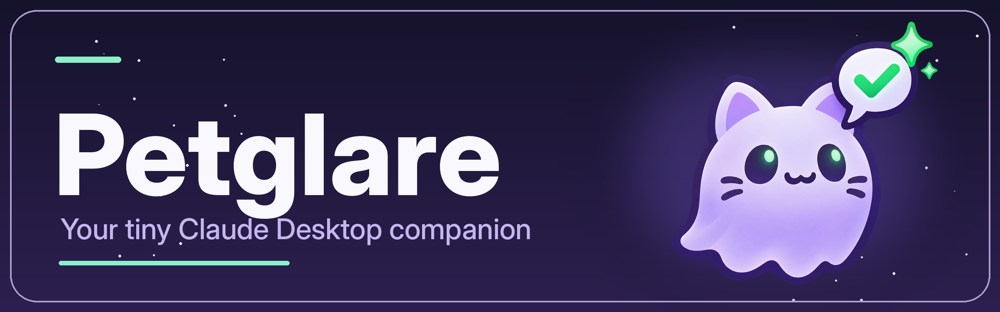

# Petglare



Petglare, Windows 11’de Claude Desktop’ın **Code → Local** oturumlarından gelen durumları gösteren küçük bir masaüstü maskotu.

## Kurulum

Windows 11 x64, Claude Desktop ve [.NET 10 Desktop Runtime x64](https://dotnet.microsoft.com/download/dotnet/10.0) gerekir.

1. GitHub Releases’tan `Petglare-Windows-x64.zip` dosyasını indir ve kalıcı bir klasöre çıkar.
2. `Kur.cmd` dosyasına çift tıkla. Kurulum Petglare hook’larını ekler ve maskotu açar.
3. Claude Desktop’ta **Code → Local** oturumu aç.

Sonraki açılışlarda `Petglare.exe` dosyasını çalıştır veya menüden **Windows açılırken başlat** seçeneğini aç. Eski bir sürümden geçiyorsan menüdeki **Bağlantı teşhisi → Hook’ları kur / onar** yeni olayları ekler. Eski bir Petglare açıksa menüden kapatıp yeni EXE’yi aç. Dosyaları taşıdıysan yeni konumdan `Kur.cmd` dosyasını tekrar çalıştır. Hook’ları kaldırmak için `Hooklari-Kaldir.cmd` dosyasına çift tıkla.

Kurulum, Claude’un kullanıcı ayarlarına yazar (`CLAUDE_CONFIG_DIR` tanımlıysa o klasöre, aksi halde `~/.claude/settings.json` dosyasına). Diğer ayarları ve hook’ları korur. Tekrar kurulum Petglare hook’larını çoğaltmaz. Komut satırından özel bir ayar dosyası için `Petglare.exe --install-hooks <dosya>` ve `Petglare.exe --uninstall-hooks <dosya>` seçeneklerini kullanabilirsin.

## Maskotu kullanma

- **Sol tık** Claude Desktop’ı açar. **Sürükleme** konumu değiştirir; ekran kenarına yakın bırakınca kenara yaslanır.
- Maskotun üzerine gelince beliren **− / +** düğmeleri boyutu %10’luk adımlarla %60 ile %200 arasında değiştirir.
- **Sağ tık** (maskotta veya bildirim alanındaki simgede) kısa bir menü açar: oturum listesi, **Ayarlar…**, **Pet Workshop…**, Claude Desktop’ı aç, maskotu gizle, bağlantı teşhisi ve kapat.
- **Ayarlar** penceresinde bütün kalıcı seçenekler tek yerde durur. Soldaki önizleme masaüstündeki maskotla aynı çizimi kullanır; çalışırken, onay, bitti, parıltı ve çoklu sohbet hallerine bakabilirsin. Değişiklikler **Uygula**’ya basınca masaüstündeki maskota geçer ve kaydedilir; **Kapat** uygulanmamış değişiklikleri bırakır.
- Bildirim alanındaki simgeye **sol tık** maskotu gizler veya geri getirir. Simgedeki renkli nokta genel durumu gösterir: mavi çalışıyor, sarı senden bir şey bekliyor, kırmızı hata, yeşil bitti.
- Petglare zaten açıkken `Petglare.exe` dosyasını tekrar çalıştırmak gizli maskotu geri getirir.

### Durumlar

Balon, `VoxForge · Program.cs düzenleniyor` gibi önce projeyi, sonra yapılan işi gösterir. Proje adı Claude’un çalışma klasöründen gelir; `.claude\worktrees\…` altındaki çalışma ağaçları ana deponun adıyla görünür.

| Durum | Ne zaman |
|---|---|
| Claude düşünüyor | İstek gönderildiğinde ve her araç bittikten sonra |
| Dosya okunuyor / düzenleniyor, Komut çalıştırılıyor, Dosyalar aranıyor, Web’e bakılıyor, Alt ajan çalışıyor | Araç başladığında |
| Komut başarısız oldu (sarı) | Araç hata döndürdüğünde, dört saniye |
| Onay bekleniyor, Sana soru soruyor, Plan onayı bekleniyor (sarı çerçeve) | Claude senden bir şey beklediğinde |
| ✓ | Ana yanıt bittiğinde, dört saniye; ardından maskotun kenarında küçük bir yıldız kalır |
| Claude API hatası | Yanıt API hatasıyla bittiğinde, beş saniye |

### Birden fazla oturum

Petglare bütün Claude oturumlarını ayrı ayrı izler ve her sohbet için ayrı bir balon gösterir; balonlar alt alta dizilir (Ayarlar’dan 1–3 arası). En önemli sohbet maskota en yakın durur: senden bir şey bekleyen sohbet hatadan, hata çalışan sohbetten, çalışan sohbet bitmiş olandan önce gelir; eşitlikte en son hareket eden kazanır. Balon boyutu %85 ile %130 arasında ayarlanır. Aynı anda iki veya daha fazla oturum çalışıyorsa maskotun köşesinde sayı görünür. Bütün oturumların listesi menünün en üstünde ve maskotun ipucunda yer alır.

Bir yanıt bitince kalan parıltı, Claude Desktop penceresine geçtiğinde veya maskota tıklayıp Claude’u açtığında kaybolur. Claude Desktop hangi sohbetin açık olduğunu dışarıya bildirmediği için Petglare, Claude penceresine bakmayı sohbetleri görmüş sayar.

### Bildirimler

Menüdeki **Bildirimler** bölümünden Windows bildirimini ve kısa sesi ayrı ayrı açıp kapatabilirsin. Bildirim; Claude onay veya yanıt beklediğinde, on saniyeden uzun süren bir yanıt bittiğinde ve hata olduğunda gelir. **Claude öndeyken sessiz kal** açıkken Claude Desktop penceresine bakıyorsan bildirim gönderilmez. Bildirime tıklamak Claude Desktop’ı açar.

### Görünüm ve ekranda kalma

- **Maskot**: üç şekil (Kedi, Damla, Hayalet) ve kendi pet’lerin, beş renk, **Maskot boyutu** (%60–200) ve **Saydamlık** (%30–100).
- **Balonlar**: dört stil, **Balon boyutu** (%85–130), aynı anda gösterilen sohbet sayısı, proje adı ve tamamlanma parıltısı.
- **Her zaman en üstte**: maskotu her saniye yeniden en üste koyar; kenarlıksız pencere modundaki oyunların üstünde de kalır. Özel (exclusive) tam ekran modundaki oyunların üstüne Windows hiçbir pencereyi çizdirmez; o oyunlarda görüntü ayarından kenarlıksız pencereyi seç.
- **Tam ekranda gizle**: aynı ekranda tam ekran bir uygulama açıkken maskotu saklar. Kapatırsan maskot oyunun, videonun veya sunumun üstünde kalır.
- **Sol tık**: *Açık*, *Tam ekranda kapalı* veya *Kapalı*. Kapalıyken sol tık Claude’u açmaz, maskotu taşımaz ve − / + düğmeleri görünmez; sağ tık menüsü her zaman çalışır. Oyun oynarken yanlışlıkla tıklamaya karşı *Tam ekranda kapalı* seçeneği uygundur.
- **Ekran kenarlarına yasla**, **Windows açılırken başlat** (`HKCU\…\Run`; EXE’yi taşırsan yeniden aç) ve **Sağ alt köşeye taşı**. Bir monitör çıkarılırsa maskot görünen bir ekrana geçer, monitör geri gelince eski yerine döner.

Boyut ve saydamlık sürgüyle tam istediğin değere ayarlanır; altındaki hazır düğmeler (%80, Opak, Küçük…) sık kullanılan değerlere atlar. Sürgü odaktayken ok tuşları 1, Page Up / Page Down 10 adım değiştirir.

### Pet Workshop: kendi pet’in

**Ayarlar → Şekil** satırındaki **+** karosu veya menüdeki **Pet Workshop…** bir görseli maskota çevirir.

1. Görseli sürükle, **Ctrl+V** ile yapıştır veya **Görsel seç…** (PNG, JPG, BMP, GIF, WebP).
2. Arka planı sil:
   - **Kenardan sil**: düz renkli arka planlar için; **Renk toleransı** benzer tonları da alır.
   - **Yapay zekâ ile sil**: fotoğraflar için. İlk kullanımda U²-Net modeli (`u2netp.onnx`, 4,4 MB, [rembg](https://github.com/danielgatis/rembg), Apache-2.0) senin onayınla bir kez indirilir ve sabit SHA-256 ile doğrulanır. Model bilgisayarında çalışır; görselin hiçbir yere gönderilmez.
3. İnce ayar: **Silgi** ve **Geri getir** fırçaları (boyut, sertlik; `[` `]`), tıklanan renk bölgesini silen **Sihirli değnek**, **Kırp**, **Kenarı daralt** (renk saçağını alır), **Kenarı yumuşat**, **Boşlukları kırp**, döndür ve çevir.
4. Sağdaki ön izleme masaüstündeki görünümü gösterir. Ad verip **Kaydet**.

Araçlar yalnız görselin üzerindeki maskeyi değiştirir; silinen yer **Geri getir** ile boyanabilir, **Ctrl+Z / Ctrl+Y** son 20 adımı geri alır. Tekerlek yakınlaştırır, sağ tık veya **Boşluk** ile sürükleme kaydırır, **Ctrl+0** sığdırır. Kısayollar: **E** silgi, **R** geri getir, **W** değnek, **C** kırp.

Pet’ler `%LOCALAPPDATA%\Petglare\Pets` altında saklanır. Ayarlar’da kendi pet’ine sağ tıklayınca **Düzenle**, **Dışa aktar** (paylaşılabilir `.petglare` dosyası) ve **Sil** çıkar; **Pet dosyası içe aktar…** başkasının `.petglare` dosyasını ekler (yalnız görsel alınır, boyutu denetlenir ve yeniden kodlanır). Kendi pet’lerinde renkler görselden gelir; durum balonları, rozet ve parıltı aynen çalışır.

### Bağlantı teşhisi

Menüdeki **Bağlantı teşhisi…** penceresi şunları gösterir: hook’ların kurulu ve bu EXE’ye bağlı olup olmadığı, eksik olaylar, yerel bağlantının dinlenip dinlenmediği, son olayın ne zaman ve hangi projeden geldiği, izlenen oturumlar ve Claude Desktop’ın çalışıp çalışmadığı. **Bağlantıyı test et** hook komutunu Claude’un çalıştıracağı şekilde çalıştırıp olayın maskota ulaştığını doğrular; **Hook’ları kur / onar** eksik olayları ekler veya taşınmış EXE’nin yolunu düzeltir. Petglare açılırken hook’lar eksikse bunu balonda ve bildirimle söyler.

## Claude olmadan deneme

Petglare açıkken aşağıdaki komutla iki projede düşünme, dosya okuma/düzenleme, başarısız komut, onay, tamamlanma ve API hatası durumlarını sırayla görebilirsin.

```powershell
.\Petglare.exe --demo | Out-Host
```

İşlem sırasında üç dakika olay gelmezse balon kapanır; onay bekleme otuz dakika görünür kalır. Altı saattir hareketsiz oturumlar listeden düşer.

Hook’lar [Claude Code hook belgelerindeki](https://code.claude.com/docs/en/hooks) `UserPromptSubmit`, `PreToolUse`, `PostToolUse`, `PostToolUseFailure`, `PermissionRequest`, `Notification` (yalnız onay ve soru bildirimleri), `Stop`, `StopFailure`, `SessionStart` ve `SessionEnd` olaylarını aynı Windows kullanıcısına ait yerel bir named pipe üzerinden iletir. Petglare prompt, dosya içeriği ve ham komut kaydetmez; yalnız olay türünü, araç türünü, dosya adını ve proje klasörünün adını iletir. Ayarlar `%LOCALAPPDATA%\Petglare\position.json` dosyasında tutulur. Başka bir Stop hook’u Claude’a devam etmesini söylerse Petglare bu kararı göremez.

## Kaynaktan derleme

.NET 10 SDK ile proje klasöründe çalıştır:

```powershell
dotnet publish -c Release -r win-x64 --self-contained false -p:PublishSingleFile=true -p:EnableSingleFileAnalyzer=false -p:DebugType=None -o .\Teslim
Compress-Archive -Path .\Teslim\Petglare.exe, .\Kur.cmd, .\Hooklari-Kaldir.cmd, .\README.md -DestinationPath .\Teslim\Petglare-Windows-x64.zip -Force
```

Kaynak dosyalarını GitHub reposuna, ZIP dosyasını GitHub Releases’a ekle.
